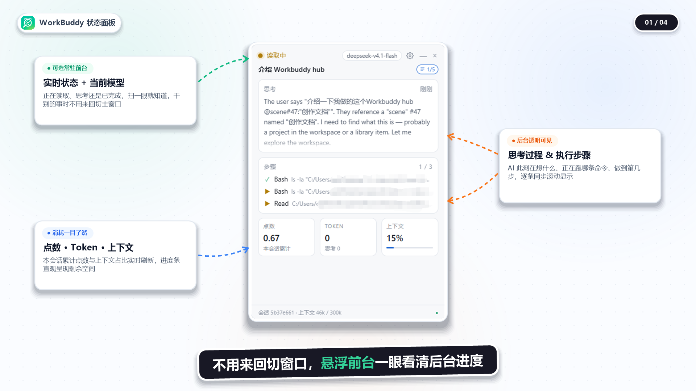

# 🖥️ WorkBuddy 状态面板

WorkBuddy 客户端本身就能看思考过程、执行步骤和权限弹窗，但你在电脑上干别的事时，主窗口通常被盖在后面。每次想知道它跑到哪一步、有没有卡在权限确认上，都得切回去看一眼。

这个小工具是一个可选择常驻桌面前台的悬浮窗口，用来解决上面这些麻烦：

- 一直浮在最上层，不用切窗口就能实时看到当前任务的思考内容、使用模型、执行步骤、点数消耗和上下文占用。
- 遇到高风险操作时会响铃提醒并弹出确认卡，可以直接在小窗里点允许或拒绝，也可以在设置里改拦截档位（关闭、只拦危险操作、每步都问）和无人应答时的超时处理方式。
- 同时跑多个任务时，可以点右上角的任务列表切到想看的那个并固定住（默认自动跟随最活跃的任务）；如果是定时任务，会把多次运行折成一组，点开就能按运行时间挑具体哪一次来查看。
- 可以在设置里自由勾选要显示哪些区块，也能自定义显示的步骤条数和思考行数。

只支持 Windows 10/11 64 位，电脑上需要先装好并登录 WorkBuddy 桌面版。整个程序是一个 3.5MB 的单文件，纯本地运行，不联网也不上传任何数据。

| 实时监控面板 | 多任务与定时任务回看 |
| :---: | :---: |
|  |  |

| 自定义与高危拦截 | 轻量开源 |
| :---: | :---: |
|  |  |

## 🚀 怎么用

### 方式一：一行命令下载（推荐，国内免翻墙）

直接把下面这行命令发给 **WorkBuddy** 让它执行，或者粘贴到 Windows **PowerShell** 中回车，会自动下载最新版并解压到桌面：

```powershell
$u="https://github.com/Payphone13/workbuddy-hud/releases/latest/download/workbuddy-hud-win-x64.zip"; $z="$env:TEMP\wb-hud.zip"; $d="$env:USERPROFILE\Desktop"; foreach($p in "https://ghfast.top/","https://gh-proxy.com/",""){try{Invoke-WebRequest "$p$u" -OutFile $z -TimeoutSec 20; if((Get-Item $z).Length -gt 100KB){break}}catch{}}; Expand-Archive $z $d -Force; Remove-Item $z -ErrorAction SilentlyContinue; explorer (Get-ChildItem $d -Directory -Filter "WorkBuddy面板*" | Sort-Object LastWriteTime -Descending | Select-Object -First 1).FullName
```

### 方式二：手动下载

1. 打开右侧 [Releases](https://github.com/Payphone13/workbuddy-hud/releases)，下载 `workbuddy-hud-win-x64.zip` 并解压。

### 启动步骤

1. 双击文件夹里的 `WorkBuddy面板.exe`。首次运行如果 Windows 弹出保护提示，点“更多信息”，再点“仍要运行”。
2. 首次打开会自动往 WorkBuddy 写入钩子。按气泡提示完全退出并重开一次 WorkBuddy，之后发任务就能在面板上看到实时状态。

默认用 `Ctrl + Alt + W` 显示或隐藏窗口，快捷键可以在设置里改。点窗口关闭按钮只是收进右下角托盘，程序还在后台运行；想彻底退出，右键托盘图标选“退出”。

## 🗑️ 卸载

不要直接删文件夹，先双击里面的 `卸载.bat` 并输入 `Y` 回车。它会自动移除写进 WorkBuddy 的钩子（操作前会备份原配置）并清掉数据目录，重开一次 WorkBuddy 后再把文件夹删掉就行。

## 🔒 数据与隐私

程序只读取本机 WorkBuddy 的会话记录和用量数据库，只在 `%USERPROFILE%\.workbuddy\settings.json` 中登记钩子，不动其他配置。本地服务仅监听 `127.0.0.1`，没有外网请求。

## 📄 许可

个人开源项目，非 WorkBuddy 官方工具。基于 [MIT License](LICENSE) 开源。
