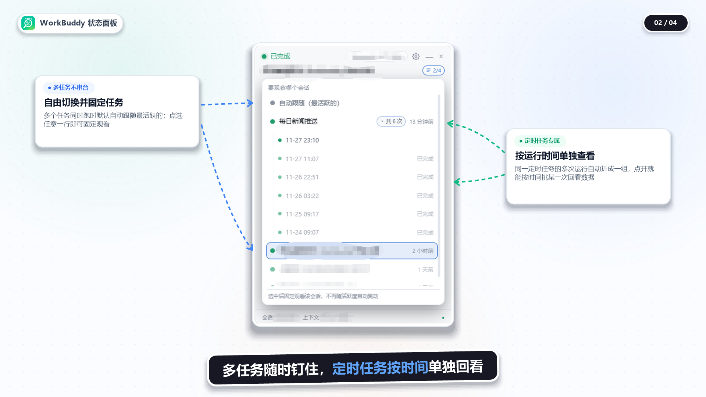
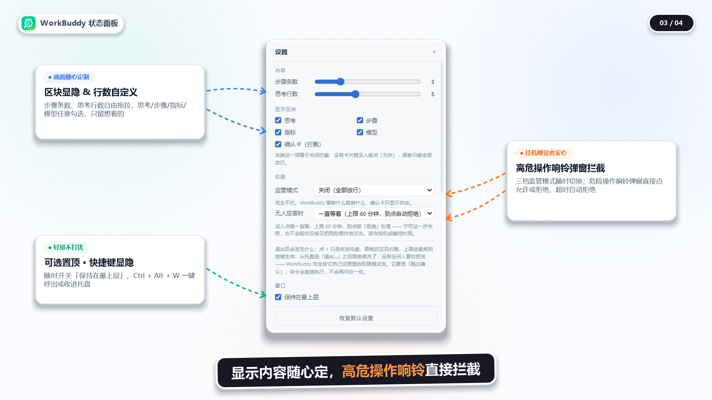
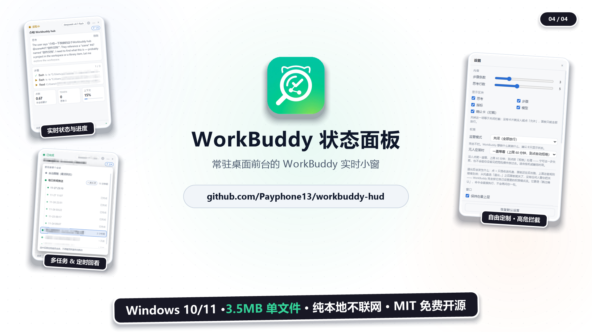

# 🖥️ WorkBuddy 状态面板

WorkBuddy 客户端本身就能看思考过程、执行步骤和权限弹窗，但你在电脑上干别的事时，主窗口通常被盖在后面。每次想知道它跑到哪一步、有没有卡在权限确认上，都得切回去看一眼。

这个小工具是一个可选择常驻桌面前台的悬浮窗口，用来解决上面这些麻烦：

- 一直浮在最上层，不用切窗口就能实时看到当前任务的思考内容、使用模型、执行步骤、点数消耗和上下文占用。
- 遇到高风险操作时会响铃提醒并弹出确认卡，可以直接在小窗里点允许或拒绝，也可以在设置里改拦截档位（关闭、只拦危险操作、每步都问）和无人应答时的超时处理方式。
- 同时跑多个任务时，可以点右上角的任务列表切到想看的那个并固定住（默认自动跟随最活跃的任务）；如果是定时任务，会把多次运行折成一组，点开就能按运行时间挑具体哪一次来查看。
- 可以在设置里自由勾选要显示哪些区块，也能自定义显示的步骤条数和思考行数。
- 支持可选的「积分」区块：查看账户剩余总点数、今日 100 积分领取状态，并支持开启每日自动领取（默认关闭，不开启时不联网）。

只支持 Windows 10/11 64 位，电脑上需要先装好并登录 WorkBuddy 桌面版。整个程序是一个 3.5MB 的单文件，**默认纯本地运行，不联网也不上传任何数据**。唯一会联网的是可选的积分功能，需要在设置里手动打开（见「数据与隐私」）。

| 实时监控面板 | 多任务与定时任务回看 |
| :---: | :---: |
|  |  |

| 自定义与高危拦截 | 轻量开源 |
| :---: | :---: |
|  |  |

## ✨ v0.6.5 更新亮点

- **修掉高 DPI 下窗口留白**：0.6.4 在系统缩放非 100%（125% / 150%）的机器上会把窗口高度多算 25%~50%，下方出现大片空白，且点「恢复自适应」也无效。本版修正单位换算，任何缩放下都贴合内容。
- **日志写在 exe 旁边**：新增 `logs` 文件夹（`hud.log` 外壳 + `service.log` 后端），记录窗口尺寸、凭据读取、客户端定位、接口状态码与耗时。设置里可直接打开文件夹或清空。两份日志都不含令牌与凭据内容。
- **积分故障能看见原因**：「未连接」不再只是一句话，下面会直接写明是「未找到客户端程序」「登录已过期」还是别的，不用悬停。
- **客户端定位更宽容**：不再只认 `C:\Program Files\WorkBuddy`，会依次查标准安装位、目录名含 workbuddy 的安装目录、注册表卸载项，装在别的盘或改了目录名也能找到。

## ✨ v0.6.4 已包含

- **可选每日积分与余额**：新增「积分」区块，可查看账户剩余总点数与今日 100 积分领取状态，支持开启每日自动领取（默认关闭，未开启时零网络请求）。
- **窗口高度自适应**：首次打开自动贴合当前勾选区块的高度，折叠后再展开固定回到屏幕右下角，不再越点越往上飘；手动拖拽一次会自动切换为手动高度，设置里随时可一键恢复。
- **底栏更清晰**：左下角会话与上下文小字提亮放大；右下角连接点改为常驻文字「已连接 / 重连中 / 已断开」，不用悬停鼠标也能一眼看清。
- **国内免翻墙一键下载**：新增 PowerShell 一行命令，直接拉取最新版并解压到桌面。

## 🚀 怎么用

### 方式一：一行命令下载（推荐，国内免翻墙）

直接把下面这行命令发给 **WorkBuddy** 让它执行，或者粘贴到 Windows **PowerShell** 中回车，会自动下载最新版并解压到桌面：

```powershell
$u="https://github.com/Payphone13/workbuddy-hud/releases/latest/download/workbuddy-hud-win-x64.zip"; $z="$env:TEMP\wb-hud.zip"; $d="$env:USERPROFILE\Desktop"; foreach($p in "https://ghfast.top/","https://gh-proxy.com/",""){try{Invoke-WebRequest "$p$u" -OutFile $z -TimeoutSec 20; if((Get-Item $z).Length -gt 100KB){break}}catch{}}; Expand-Archive $z $d -Force; Remove-Item $z -ErrorAction SilentlyContinue; explorer (Get-ChildItem $d -Directory -Filter "WorkBuddy面板*" | Sort-Object LastWriteTime -Descending | Select-Object -First 1).FullName
```

### 方式二：手动下载

1. 打开右侧 [Releases](https://github.com/Payphone13/workbuddy-hud/releases)，下载 `workbuddy-hud-win-x64.zip` 并解压，得到 `WorkBuddy面板-<版本>-win-x64` 文件夹。

### 启动步骤

1. 双击文件夹里的 `WorkBuddy面板.exe`。首次运行如果 Windows 弹出保护提示，点“更多信息”，再点“仍要运行”。
2. 首次打开会自动往 WorkBuddy 写入钩子。按气泡提示完全退出并重开一次 WorkBuddy，之后发任务就能在面板上看到实时状态。

默认用 `Ctrl + Alt + W` 显示或隐藏窗口，快捷键可以在设置里改。点窗口关闭按钮只是收进右下角托盘，程序还在后台运行；想彻底退出，右键托盘图标选“退出”。

## 🗑️ 卸载

不要直接删文件夹，先双击里面的 `卸载.bat` 并输入 `Y` 回车。它会自动移除写进 WorkBuddy 的钩子（操作前会备份原配置）并清掉数据目录，重开一次 WorkBuddy 后再把文件夹删掉就行。

## 🔒 数据与隐私

程序默认只读取本机 WorkBuddy 的会话记录和用量数据库，只在 `%USERPROFILE%\.workbuddy\settings.json` 中登记钩子，不动其他配置。本地服务仅监听 `127.0.0.1`。

**关于积分功能（默认关闭）**

「积分」功能默认关闭，不勾选时程序不发任何网络请求，也不会读取本机登录态。

## 🩺 出问题了怎么办

打开设置 → **诊断日志**，点「打开日志文件夹」，里面有两个文件：

| 文件 | 内容 |
|---|---|
| `hud.log` | 外壳：版本、exe 路径、显示器缩放、窗口尺寸变化、后端端口 |
| `service.log` | 后端：凭据读取路径、客户端定位结果、解密耗时、每个接口的状态码与耗时、积分结论 |

把这两份一起发出来即可定位问题。**日志不含令牌、凭据内容和请求头**，但会记录本机路径与用户名，所以适合发给开发者，不适合公开发到论坛。单个文件超过 2 MB 会自动滚动，最多占 8 MB。

积分一栏显示「未连接」时，区块下方会直接写出原因，先看那一行通常就知道该做什么：

| 提示 | 处理 |
|---|---|
| 未找到客户端程序 | 确认 WorkBuddy 已正常安装（不必正在运行），日志里会列出搜过的路径 |
| 客户端未登录 | 打开 WorkBuddy 登录一次，再点面板上的「刷新」 |
| 登录已过期，请在客户端重新登录 | 同上，令牌已失效 |
| 凭据文件被占用 | 等几秒再刷新；客户端正在写这个文件 |
| 请求超时或网络不通 | 检查网络与代理设置 |

手动开启后，它只直连 WorkBuddy 官方接口（不经过任何第三方服务器），用来查账户剩余点数、查今天领没领，以及在开启自动领取时帮你领当天的 100 积分。读取到的本机登录令牌只在内存里短暂使用，不写硬盘、不进日志，退出即消失。

另外说明：积分与余额调用的是客户端内部接口，如果以后 WorkBuddy 大版本更新改了接口，这一块可能会暂时失效并显示「未连接」，不影响面板的其他功能。

凭据解密模块移植自 [88lin/workbuddy-auto-signin](https://github.com/88lin/workbuddy-auto-signin)（MIT），详见 [NOTICE-第三方代码.md](NOTICE-第三方代码.md)。

## 📄 许可

个人开源项目，非 WorkBuddy 官方工具。基于 [MIT License](LICENSE) 开源。
